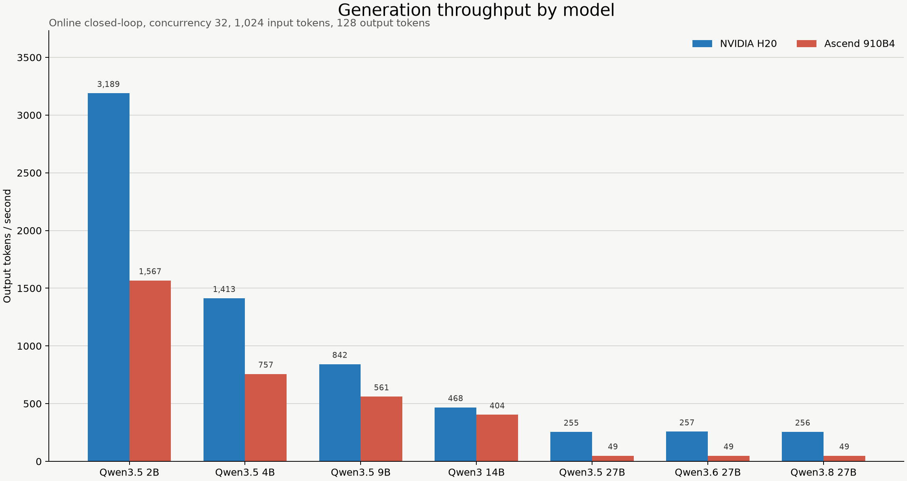

# HeteroInferLab

Reproducible single-accelerator inference benchmarking across NVIDIA H20 and
Huawei Ascend 910B4.

HeteroInferLab compares Qwen models from 2B to 27B under controlled prompt
lengths, output lengths, batching, optimization settings, and request arrival
patterns. It reports throughput, TTFT, TPOT, ITL, and end-to-end tail latency.

> 中文定位：面向 H20 与 Ascend 910B4 的异构大模型推理基准与性能调优实验。

## Key results

- Completed a `480/480`-cell throughput sweep and collected 1,326 valid
  performance measurements.
- Completed a `728/728`-cell request-level latency matrix covering 58,240
  successful requests.
- Verified 23,520 paired cross-hardware request inputs with zero hash
  mismatches in the selected latency dataset.
- At 1K input, 128 output, combo configuration, and HTTP concurrency 32, H20
  delivered about `2.03x` and `1.87x` the 910B4 throughput for Qwen3.5-2B and
  Qwen3.5-4B respectively.
- The result is workload-dependent: 910B4 was competitive or faster for
  selected short-output and TTFT-sensitive cases.
- On the tested 27B stack, increasing combo concurrency from 8 to 32 caused a
  major throughput and P95 latency regression. This is an observed deployment
  result, not a proven chip-level root cause.



## What does "480 cells" mean?

Each cell is one unique benchmark configuration:

```text
2 hardware targets
x 5 models
x 2 configurations
x (2 input lengths x 3 output lengths)
x 4 batch sizes
= 480 cells
```

For example, the following is one cell:

```text
H20 x Qwen3.5-4B x combo x 1024 input x 128 output x batch 32
```

A cell is not a scheduler job and not a single request. One job may execute
many cells, and a cell may contain multiple requests or repeated measurements.

## Experiment scope

### Throughput sweep

- Hardware: NVIDIA H20, Ascend 910B4-64G
- Precision: BF16
- Tensor parallelism: TP=1
- Models: Qwen3.5-2B/4B/9B, Qwen3-14B, Qwen3-4B
- Input tokens: 1,024 and 2,048
- Output tokens: 1, 64, and 128
- Batch sizes: 1, 8, 32, and 128
- Independent probes: eager baseline, graph/compile, chunked prefill, prefix
  cache, FP8, and MTP where supported

### Request-level latency

- Added Qwen3.5/3.6/3.8-27B same-size comparisons
- Offline asynchronous token delivery and loopback OpenAI-compatible SSE
- Closed-loop concurrency 1/8/32
- Open-loop Poisson arrivals at rates derived from each deployment's measured
  closed-loop window
- Metrics: TTFT, TPOT, exact observable ITL, E2E P50/P95/P99, throughput

## Repository layout

```text
src/
  throughput_benchmark.py   Fixed-token throughput and quality benchmark
  latency_benchmark.py      Async and HTTP streaming latency benchmark
analysis/
  validate_public_results.py
  plot_public_results.py
data/
  manifest.json             Pinned models for the throughput sweep
  latency_model_manifest.json
  workload.jsonl            512 selected SQuAD v1.1 examples
results/
  throughput/               Aggregated throughput data and charts
  latency/                  Selected request-level summaries and charts
docs/
  RESULTS.md                Main conclusions and limitations
  METHODOLOGY.md            Protocol and metric definitions
  STAR.md                   Resume and interview narrative
  CONVERSATION_HISTORY.md   Sanitized project conversation history
```

## Reproduction

Install the lightweight dependencies used by validation and plotting:

```bash
python -m pip install -r requirements.txt
```

The benchmark runners additionally require `transformers`, `aiohttp`, and a
working platform-specific vLLM environment. Install NVIDIA or Ascend runtime
packages according to the corresponding vLLM backend documentation; they are
not pinned in this cross-platform analysis requirements file.

Prepare a directory containing `manifest.json`, `workload.jsonl`, and one local
model directory per manifest tag:

```text
/tmp/ib/
  manifest.json
  workload.jsonl
  2b/
  4b/
  9b/
  14b/
  q3-4b/
```

Run a throughput sweep:

```bash
python src/throughput_benchmark.py \
  --device cuda \
  --root /tmp/ib \
  --model 4b \
  --config baseline \
  --suite sweep
```

Run offline request-level latency:

```bash
python src/latency_benchmark.py \
  --device cuda \
  --root /tmp/ib \
  --model 4b \
  --config combo \
  --mode offline
```

Run online latency against an isolated, OpenAI-compatible vLLM endpoint:

```bash
python src/latency_benchmark.py \
  --device cuda \
  --root /tmp/ib \
  --model 4b \
  --config combo \
  --mode online \
  --url http://127.0.0.1:18081
```

Validate the published aggregate datasets and rebuild the public comparison
chart:

```bash
python analysis/validate_public_results.py
python analysis/plot_public_results.py
```

## Important interpretation limits

- This compares complete hardware and software deployments, not isolated chip
  peak compute.
- H20 and 910B4 used different runtime stacks.
- HTTP measurements used worker-local loopback and exclude production gateways
  and external networks.
- Fixed output lengths describe compute shapes, not natural answer quality.
- Latency cells are bounded sample sets without independent P95 confidence
  intervals.
- Open-loop rates were derived independently per deployment and must not be
  interpreted as equal absolute-QPS cross-hardware comparisons.
- Raw scheduler logs and request-level traces are intentionally not published:
  they contained environment-specific metadata and exceeded practical GitHub
  size limits. Aggregated, validated CSV data is included.

## Documentation

- [Results and conclusions](docs/RESULTS.md)
- [Methodology](docs/METHODOLOGY.md)
- [STAR narrative](docs/STAR.md)
- [Sanitized conversation history](docs/CONVERSATION_HISTORY.md)

SQuAD v1.1 data is redistributed with attribution to the original dataset.
Qwen model weights are not included.
