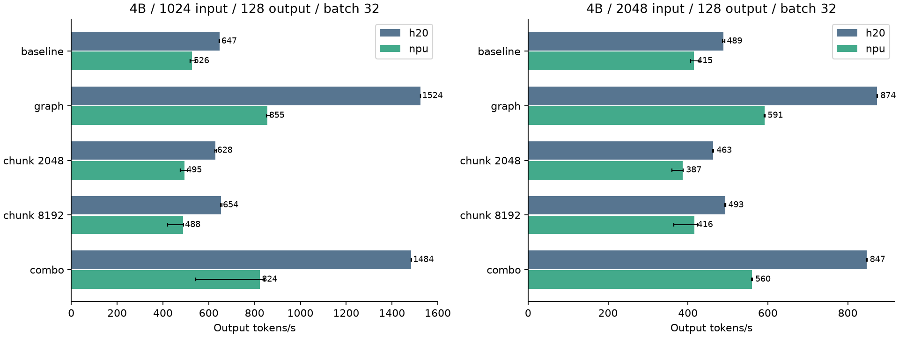
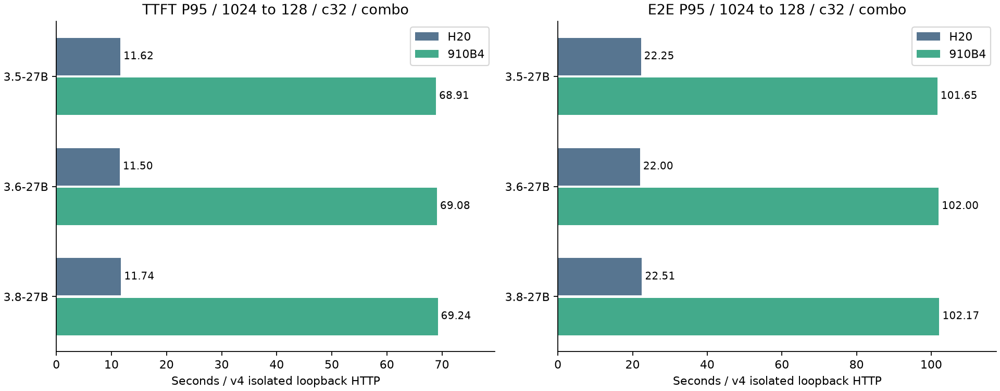

# 实验结果：什么时候选 H20，什么时候考虑 910B4

如果还不能区分 H20/910B4 硬件与各自的软件栈，请先读[逐步教程](一步步认识H20与910B4推理对比项目-friendly.md)。

## 这组实验回答了什么

本项目比较 H20 与 Ascend 910B4 的**完整单卡推理部署**。比较对象不只是芯片，还包括各自的 vLLM 后端、运行时、编译器和算子。

最稳妥的结论是：

> 小模型长输出生成优先考虑 H20；短输出判断或首 token 敏感场景需要逐模型比较；所测 910B4 部署栈不适合直接把 27B 组合配置推到并发 32。

这不是通用硬件排名。模型结构、输入长度、输出长度、优化配置和并发都会改变结果。

本文把“图/编译路径 + chunked prefill”的组合配置简称为 `combo`。这些优化的作用见 [实验方法](METHODOLOGY.md)。

## 一张表看懂选型

| 场景 | 本次实验中的较优选择 | 证据 | 结论强度 |
|---|---|---|---|
| Qwen3.5-2B/4B，长输出生成 | H20 | 1,024 输入、128 输出、`combo`、在线并发 32，H20 吞吐为 2.03x/1.87x | 该固定场景的直接观察 |
| 9B 单 token 判断 | 910B4 略快 | 9.96 vs 9.13 requests/s | 差距较小，换环境需复测 |
| 14B 单 token 判断 | 910B4 | 7.09 vs 4.84 requests/s | 该固定场景的直接观察 |
| 14B、64 token 提取形状 | 910B4 略快 | 283 vs 267 output tokens/s；E2E P95 9.03 vs 10.83 s | 差距不大，需结合延迟预算 |
| 27B、长输出、高并发 | H20；910B4 先降并发复验 | 所测 910B4 栈从并发 8 到 32 后吞吐减半、P95 放大 | 已复现现象，根因未知 |

表里的数字只有在模型、输入输出长度、配置和并发相同时才可直接比较。

## 结果一：2B/4B 长输出生成，H20 优势明确

固定条件：

- 在线闭环请求；
- 1,024 输入 token；
- 128 输出 token；
- `combo` 配置；
- 并发 32。

| 模型 | H20 output tok/s | 910B4 output tok/s | H20 / 910B4 |
|---|---:|---:|---:|
| Qwen3.5-2B | 3,189.35 | 1,567.26 | 2.03x |
| Qwen3.5-4B | 1,413.03 | 757.44 | 1.87x |

图中柱越高，单位时间生成的 token 越多。2B 和 4B 的差距最大；模型增大到 14B 后，两端差距明显缩小。


这张图不能单独支持“H20 总是更快”。同一矩阵中，910B4 在 9B/14B 的部分短输出和首 token 指标上更好。

## 结果二：优化项不能简单叠加

下面是 4B、1,024 输入、128 输出、batch 32 的三次重复中位数。

| 配置 | H20 tok/s | 910B4 tok/s | 如何理解 |
|---|---:|---:|---|
| baseline | 647 | 526 | eager 基线 |
| graph | 1,524 | 855 | 两端都有明显收益 |
| chunk 2048 | 628 | 495 | 这组固定长度负载没有收益 |
| chunk 8192 | 654 | 488 | 仍未优于基线 |
| combo | 1,484 | 824 | 没有超过 graph 单独开启 |
| FP8 | 1,986 | 未测 | H20 上比 graph 再高约 30% |
| MTP | 1,426 | 未测 | H20 上未形成稳定收益 |



这组证据说明：

1. Graph/compile 是 4B 长输出中的主要收益来源。
2. Chunked prefill 适合解决长提示和调度问题，但在这组固定长度离线吞吐负载中没有提高吞吐。
3. `combo` 同时打开多个优化，不保证比最好的单项更快。
4. FP8 的性能收益只在 H20 路径上验证；不能把 NPU 的空缺当作零收益。

## 结果三：吞吐与首 token 延迟可能给出不同答案

以 9B、1K→128、combo、在线并发 32 为例：

| 指标 | H20 | 910B4 | 较优 |
|---|---:|---:|---|
| 请求吞吐 | 6.58 req/s | 4.38 req/s | H20 |
| TTFT P95 | 3.20 s | 3.10 s | 910B4 略低 |
| E2E P95 | 6.40 s | 8.41 s | H20 |

这不是矛盾。TTFT 只看第一个 token 何时出现；请求吞吐和 E2E 还受后续生成速度影响。若业务强调“尽快看到第一个字”，选择可能不同于“尽快生成完整答案”。

14B 也出现类似现象：910B4 的首 token 更快，但 H20 的 128-token 生成吞吐略高。因此硬件选型至少要同时看 TTFT、TPOT/E2E 和吞吐。

## 结果四：27B 在所测 910B4 栈上出现高并发退化

固定为 1K→128、combo、在线闭环。三套同规模模型的表现几乎相同：

| 模型 | 并发 8 tok/s | 并发 32 tok/s | E2E P95：并发 8 → 32 |
|---|---:|---:|---:|
| Qwen3.5-27B | 97.8 | 49.0 | 10.26 s → 101.65 s |
| Qwen3.6-27B | 97.4 | 48.9 | 10.36 s → 102.00 s |
| Qwen3.8-27B | 97.3 | 48.8 | 10.32 s → 102.17 s |

并发增加后：

- output tokens/s 约下降一半；
- TTFT P95 从约 2.7 秒升至约 69 秒；
- E2E P95 从约 10 秒升至约 102 秒。



三个 checkpoint 都出现相似现象，因此“某个模型版本独有的问题”不是强解释。但当前实验没有 profiler、抢占历史或完整 KV cache 时间线，所以只能写：

> 所测 910B4 部署栈在 27B、combo、并发 32 下出现退化。

不能写成：

> 910B4 芯片因为某个已知机制导致退化。

实际部署前，应先用并发 8 或更低并发复验，再逐步提高并发，同时采集调度和显存证据。

## 数据是否完整

公开数据通过以下检查：

| 检查项 | 结果 |
|---|---:|
| 吞吐主矩阵 | 480/480 格 |
| 底层吞吐测量 | 1,326 次 |
| 延迟矩阵 | 728/728 格 |
| 正式延迟请求 | 58,240/58,240 成功 |
| 跨硬件输入配对 | 23,520 对 |
| 输入哈希不一致 | 0 |

输入哈希一致只证明两端接收了相同 token 输入，不证明两端输出语义完全相同。

## 如何读取 CSV

`results/latency/summary.csv` 每一行是一格请求级延迟实验。比较两行之前，至少确认这些列相同：

```text
model
config
mode
arrival
input_tokens
output_tokens
concurrency
```

然后根据问题选择指标：

- 想看系统总产能：`requests_s` 或 `output_tokens_s`；
- 想看多久出现首 token：`ttft_s_p95`；
- 想看后续生成速度：`tpot_s_p95`；
- 想看完整请求的尾延迟：`e2e_s_p95`。

`results/throughput/summary.csv` 还包含消融和重复测量。`n` 是聚合进该行的测量次数，`min_requests_s` 与 `max_requests_s` 可帮助判断波动。

## 结论的适用范围

以下限制会实质影响解释：

1. 两端软件栈不同，因此结果属于完整部署，不是纯芯片比较。
2. HTTP 使用 worker 本机 loopback，不含生产网关和外部网络。
3. 固定输出长度控制计算形状，不等同于自然答案质量。
4. 每个延迟格是有界样本集合，没有为每个 P95 单独计算置信区间。
5. 开放到达率按两端各自闭环结果计算，不能当作相同绝对 QPS 的硬件对照。
6. 原始请求轨迹和调度日志因体积和环境元数据未公开；公开仓库提供聚合 CSV 与校验结果。
